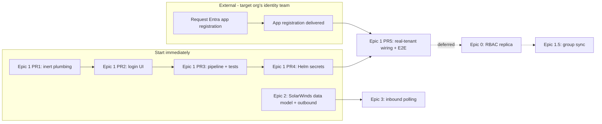

# DefectDojo (Personal Fork) — Integrations Delivery Plan

**Scope:** Microsoft Entra ID (Azure AD) SSO, a role-based access control reactivation ("Epic 0"), and a bidirectional SolarWinds Service Desk ticketing integration, for this private DefectDojo fork.
**Status:** Approved for execution. Architecture decisions final; one SSO PR is blocked on an external app-registration request (see §5, in `docs/integrations/epic1-sso.md`). Epic 0 (§7, in `docs/integrations/epic0-rbac-reactivation.md`) moved from deferred to active on 2026-08-09 — see that file for the full spec.
**Last updated:** 2026-09-19 (Epic 3 review-fix pass, volume-control + manual-trigger pass, and a critical `.json` wire-format fix — R28-R33; also split into per-epic files, see the Documentation Map below)

**Design principle — organization-agnostic by construction:** this fork is meant to function as a personal, general-purpose equivalent to DefectDojo Pro — deployable against whichever organization's Entra tenant and SolarWinds instance the operator points it at, not wired to any one employer or org. Every identity/tenant-specific value (Entra tenant ID, allowed email domain(s), SolarWinds instance URL/region, credentials) is **runtime configuration** (env vars / admin-configured model fields), never hardcoded into settings, code, or migrations. Nothing in this plan or its implementation should assume a specific organization's name, domain, or tenant — treat every such value below as a placeholder to fill in per-deployment.

This document (and the files it links to) is the reference for delivering all three initiatives. It is intentionally not part of the public `docs/content/` Hugo site — it's internal planning, not end-user documentation.

---

## Documentation Map

This plan outgrew a single file across three epics and multiple build/review passes, so it's split by semantic area. This master file carries the cross-cutting narrative (why, what, in what order); the linked files carry the technical specs, the accumulated risk register, and the task-completion record.

| File | Contains | Depends on |
|---|---|---|
| **`INTEGRATIONS_ROADMAP.md`** (this file) | Executive Summary, why RBAC work wasn't originally scoped, Finalized Decisions, Epic Breakdown (with the dependency graph), Rollout Plan, Key Files Referenced | Nothing — this is the entry point |
| [`docs/integrations/epic1-sso.md`](docs/integrations/epic1-sso.md) | Epic 1 (SSO) — the Entra app-registration request template and the full technical spec (§5-§6) | Nothing technical — blocked only externally on an Entra app registration |
| [`docs/integrations/epic0-rbac-reactivation.md`](docs/integrations/epic0-rbac-reactivation.md) | Epic 0 (RBAC reactivation) — full technical spec (§7) | Nothing — independent of Epic 1/1.5. Its own §7.9 documents the (minimal) SSO interaction |
| [`docs/integrations/epic2-3-solarwinds.md`](docs/integrations/epic2-3-solarwinds.md) | Epic 2 & 3 (SolarWinds Service Desk) — the IT/ITSM request template and full technical spec (§8) | Nothing — fully independent of Epic 0/1, no shared code paths beyond general repo conventions |
| [`docs/integrations/risk-register.md`](docs/integrations/risk-register.md) | The consolidated Risk Register (§9, R1-R33) | **Not owned by any epic** — referenced by ID from all three epic files and from this file's Finalized Decisions (§3's named assumptions) |
| [`docs/integrations/task-list.md`](docs/integrations/task-list.md) | The consolidated Engineering Task List (§11) — PR/pass-by-pass completion status for all three epics | **Not owned by any epic** — cross-cutting tracker, same relationship to the epics as the Risk Register |

**Reading order for someone new to this plan:** this file first (Executive Summary through Epic Breakdown), then whichever epic file matches the work at hand, consulting the Risk Register and Task List as that epic's content points you to specific `R#` IDs or completion status. The Risk Register and Task List are worth skimming on their own too — they're the most current record of what's actually shipped versus still open, more current in places than the technical-spec prose that precedes an implementation pass.

**Section numbering is preserved from before the split**, not renumbered — §5/§6 live in the SSO file, §7 in the RBAC file, §8 in the SolarWinds file, §9 in the Risk Register, §11 in the Task List. This file keeps §1-§4, §10, and §12. A reference like "§8.3" always means the same subsection regardless of which file you're reading it from; this file's cross-references name the target file explicitly the first time a section is mentioned.

---

## 1. Executive Summary

We're adding Microsoft Entra ID **OIDC** single sign-on and a **SolarWinds Service Desk** ticketing integration to this fork, in that priority order. Both are scoped to ship without requiring any Pro-only DefectDojo feature — see §2 for why.

- **SSO:** re-adopt upstream DefectDojo's own pre-3.0 `social-auth-app-django` + Azure AD OIDC integration. Local username/password login stays available to everyone. New SSO users are provisioned just-in-time with zero privilege; access is granted manually via the existing Authorized Users UI.
- **SolarWinds:** a new `dojo/solarwinds/` module creates a Service Desk incident when a finding opens (outbound, async via Celery) and polls for resolution to mitigate the finding (inbound, Celery-beat — **SolarWinds Service Desk has no webhook capability**, confirmed against its real API spec).

**Critical path:** an Entra app registration must be requested from whichever organization's identity team owns the target tenant before final SSO wiring/testing (§5, in `docs/integrations/epic1-sso.md`). Everything else — SSO plumbing, the SolarWinds module — can be built and merged (dark, behind flags) starting immediately, independent of which org it's eventually pointed at.

---

## 2. Why This Doesn't Require Rebuilding DefectDojo Pro's RBAC

> **Superseded 2026-08-11 — kept for the record, not as current design.** This section explains why the SSO epic shipped without any RBAC work, and it was right about that. It is no longer a statement about where this fork stands: Epic 0 (§7, in `docs/integrations/epic0-rbac-reactivation.md`) reactivated the dormant RBAC schema, and as of PR 7 the engine, REST API and UI panels are all in the tree with `DD_FEATURE_RBAC` defaulting to `shadow`. Read that file for the design that is actually live. Two specific claims below are now historical: "there are no roles, no groups, and no global roles" describes upstream open-source, not this fork; and the conclusion's "that was sufficient to ship SSO" is scoped to the SSO delivery, not to the fork's access model today.

Upstream's own documentation confirms two things that shape this whole plan:

> "Single Sign-On is a **DefectDojo Pro** feature. As of DefectDojo 3.0, the SSO surface — SAML, OIDC, and the bundled OAuth providers — is available only in DefectDojo Pro." — `docs/content/admin/sso/_index.md`

> "Open-source DefectDojo controls access to Products and Product Types with the **Authorized Users** model... There are no roles, no groups, and no global roles." — `docs/content/admin/user_management/OS__authorized_users.md`

So: SSO was removed from open-source DefectDojo org-wide at the 3.0 release (not stripped specifically from this fork — this fork just carries pre-3.0 remnants: `LOGIN_EXEMPT_URLS` entries for `complete/`/`oauth2/idpresponse`, and a `Dojo_Group.social_provider` field). And OS authorization was **deliberately moved back to** a simple `is_superuser` / `is_staff` / per-Product(-Type) `authorized_users` list model — confirmed live and working in this codebase:

- `dojo/db_migrations/0268_release_authorization_to_pro.py` re-introduced `Product.authorized_users` / `Product_Type.authorized_users` as real (`managed=True`) M2M fields when the RBAC tables (`Dojo_Group`, `Role`, `Product_Member`, etc.) were handed to Pro as `managed=False` shells.
- `dojo/authorization/authorization.py` implements authorization purely against `is_superuser` / `is_staff` / `authorized_users` — the RBAC shells are never consulted.
- The UI already exists: "Add Authorized User" panel on the Product and Product Type detail pages (`dojo/product/ui/views.py:1666`, `add_product_authorized_users`).

**Conclusion (superseded — see the note at the top of this section and §7 in `docs/integrations/epic0-rbac-reactivation.md`; the reasoning above still holds for what it claimed at the time):** an SSO-provisioned user is just an ordinary `Dojo_User` row, immediately assignable through the Authorized Users panel, and that was sufficient to ship SSO without any RBAC work — nothing above was wrong. What changed is a downstream requirement: `authorized_users` is all-or-nothing per Product/Product Type (no read-only tier), which blocks granting stakeholders read-only access while dev teams get edit access. That's not an SSO problem — it surfaced *because* SSO made onboarding easy enough to expose the gap — and it doesn't require Entra group-claim sync (Epic 1.5 stays deferred, untouched). It requires the RBAC schema this fork already has sitting inert in its database (§7). Epic 0 is now active.

---

## 3. Finalized Decisions

| # | Decision | Answer |
|---|---|---|
| 1 | Protocol | **OIDC**, not SAML |
| 2 | Library | **`social-auth-app-django`** with the `social_core.backends.azuread_tenant.AzureADTenantOAuth2` backend — re-adopting upstream's own pre-3.0 approach |
| 3 | Local login | **Stays available to everyone**, not restricted to a break-glass account. `ModelBackend` remains second in `AUTHENTICATION_BACKENDS`. |
| 4 | Provisioning | **Just-in-time** on first SSO login, restricted to the configured tenant/domain (per-deployment, env-driven), new users get zero privilege by default |
| 5 | Role assignment | **Manual**, via the Authorized Users, Members and Groups panels. Unchanged by Epic 0 — reactivating RBAC added role granularity, not automation. Automated Entra-group sync stays deferred (Epic 1.5). |
| 6 | Authorization schema | ~~No RBAC replica for this delivery (§2)~~ — **revised 2026-08-09**: per-product role granularity did become a hard requirement, which is exactly the revisit condition this row named. The dormant RBAC schema is reactivated in **Epic 0 (§7, in `docs/integrations/epic0-rbac-reactivation.md`)**, gated behind `DD_FEATURE_RBAC`. |
| 7 | SolarWinds inbound sync | **Celery-beat polling.** Confirmed: Service Desk's API has zero webhook support (§8, in `docs/integrations/epic2-3-solarwinds.md`). |
| 8 | Credentials | Secret-store / encrypted-at-rest only, for both integrations — never a plaintext DB column (the JIRA module's `password = CharField` is the anti-pattern being explicitly avoided) |

### Named assumptions (carried as risks, not blockers — see the Risk Register, `docs/integrations/risk-register.md`)
- **A1:** Entra will emit the standard OIDC claims (email/`preferred_username`, `oid`, `tid`); exact optional-claims config is owned by IT.
- **A2:** The `pro` package will not be installed into this deployment during this initiative.
- **A3:** A dedicated SolarWinds Service Desk service-account admin can be created to own the integration's API token.

---

## 4. Epic Breakdown

| Epic | Status | Depends on |
|---|---|---|
| **Epic 1** — SSO Core (Entra OIDC) | **Shipped**, local E2E verified 2026-08-08 | Entra app registration (final wiring PR only) |
| **Epic 0** — Authorization reactivation (RBAC tables + roles) | **Active** — spec finalized 2026-08-09 (§7, in `docs/integrations/epic0-rbac-reactivation.md`), no PRs merged yet | None — independent of Epic 1/1.5 |
| **Epic 1.5** — SSO group → role sync | **Deferred** — not started, not needed for Epic 0 | Epic 0, Epic 1, IT group-claims config |
| **Epic 2** — SolarWinds data model + outbound sync | **Configuration surface complete 2026-09-18** — every Epic 2 item in `docs/integrations/task-list.md` is checked off (models/migration `0279`, encrypted token, client, payload builder, discovery helper, config UI + REST API). The outbound `finding.save()` hook itself is tracked under Epic 3, where it has always been listed. | None — can run in parallel with Epic 1 |
| **Epic 3** — SolarWinds inbound polling sync | **Complete 2026-09-19** — outbound hook, inbound polling, review-fix pass, volume-control pass, and the R33 wire-format fix all shipped. See `docs/integrations/task-list.md`. | Epic 2 |

**Day-1 actions, both in parallel:**
1. File the Entra app-registration request with the target organization's identity/IT team (spec in §5, `docs/integrations/epic1-sso.md`) — starts the external clock.
2. Begin Epic 1 PR 1 — no external dependency.

Epic 2 (SolarWinds) has no SSO dependency and should run concurrently so the team stays utilized while the Entra request is outstanding.

---

## 10. Rollout Plan

1. **Dark launch:** merge Epic 1 PR 1/2 with the flag off — zero production effect.
2. **Staging enablement:** flag on in staging against the real Entra app registration (PR 5); run the full E2E checklist (first login, repeat login, logout, break-glass, single-session).
3. **Pilot cohort:** enable in prod for a small stakeholder + dev group; local login remains fully available; grant access manually (dev team → `is_staff`, stakeholders → per-product `authorized_users`).
4. **GA:** announce; keep local login for everyone; monitor break-glass usage.
5. **SolarWinds:** roll Epic 2 to one pilot product first (validate the tenant-specific lookups + token), then broaden; enable Epic 3 polling only after outbound is stable.
6. **Rollback:** SSO → flip the flag off (instant; JIT-created users remain, harmless). SolarWinds → disable the per-product mapping or pause the Celery-beat task.

---

## 12. Key Files Referenced

- `dojo/settings/settings.dist.py` — `AUTHENTICATION_BACKENDS` (469), `CLASSIC_AUTH_ENABLED` (486), `LOGIN_EXEMPT_URLS` (508-523), `INSTALLED_APPS` (773), `MIDDLEWARE` (806-824), `CELERY_IMPORTS` (947), `CELERY_BEAT_SCHEDULE` (954 — was cited as 906, corrected 2026-09-18). Line numbers in this section are the ones most prone to drift; re-grep before relying on any of them.
- `dojo/db_migrations/0268_release_authorization_to_pro.py` — RBAC-to-Pro release, `authorized_users` reintroduction
- `dojo/authorization/authorization.py` — OS enforcement path
- `dojo/authorization/models.py` — the eight `managed=False` RBAC shells, `Dojo_Group.social_provider`
- `dojo/product/ui/views.py:1666` — `add_product_authorized_users`
- `dojo/user/ui/views.py:57` — `DojoLoginView`
- `dojo/user/models.py` — `Dojo_User` (proxy model), `UserContactInfo`
- `dojo/jira/models.py`, `dojo/jira/helper.py`, `dojo/jira/views.py` — structural reference for Epic 2/3 (not the layout to copy — see `AGENTS.md`)
- `dojo/finding/helper.py:1238` — `_save_finding_with_jira_sync`, the pattern Epic 3's hook mirrors (verified accurate 2026-09-18); `close_finding` at `:1261` is the canonical mitigation path the inbound poll goes through
- `dojo/solarwinds/helper.py`, `dojo/solarwinds/tasks.py` — Epic 3's orchestration and Celery entry points
- `dojo/jira/helper.py:591-620` — `log_jira_alert`/`log_jira_generic_alert`, the admin-notification precedent the SolarWinds alerting follows
- `dojo/utils.py:1026` — `dojo_crypto_encrypt`
- `dojo/tool_config/ui/views.py:57,80` — encryption usage pattern
- `AGENTS.md` — canonical `dojo/url/` module layout for `dojo/solarwinds/` and any future `dojo/sso/` module
- `resolved_schema.json` (repo root) — real SolarWinds Service Desk OpenAPI spec
- `docs/content/admin/sso/_index.md`, `docs/content/admin/sso/PRO__azure_ad.md`, `docs/content/admin/user_management/OS__authorized_users.md` — upstream's own documentation confirming the 3.0 SSO/RBAC split
